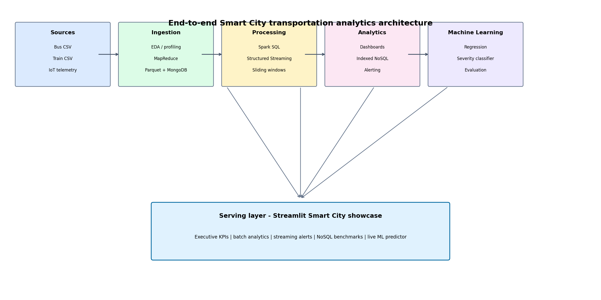

# Comparative Study of Transport Modes: Big Data Analysis of Bus vs Train Delays

**Group 17 - Big Data Analytics practical submission**

An end-to-end Smart City transportation analytics platform that compares bus and train delay behaviour across ingestion, distributed processing, batch SQL, real-time streaming, NoSQL indexing, dashboards and machine learning.

| Item | Value |
|---|---|
| Author | **Junaid Shaikh** |
| Project | Group 17 - Bus vs Train Delay Analytics |
| Status | All 10 experiments completed and verified |
| Dataset | 50,000 synthetic bus trips + 50,000 synthetic train trips |
| Primary stack | PySpark 3.5.1, Spark SQL, Spark Structured Streaming, MongoDB, scikit-learn, Streamlit |
| Python | 3.11.x |
| License | MIT - see [LICENSE](LICENSE) |
| Repository | https://github.com/Ken-Kanike/BDA_Practicals |

---

## Table of Contents

1. [Project Overview](#project-overview)
2. [Key Results](#key-results)
3. [Architecture](#architecture)
4. [Repository Layout](#repository-layout)
5. [Dataset](#dataset)
6. [Verified Environment](#verified-environment)
7. [Installation](#installation)
8. [MongoDB Setup](#mongodb-setup)
9. [Spark and Windows Setup](#spark-and-windows-setup)
10. [Running the Experiments](#running-the-experiments)
11. [Experiment Details](#experiment-details)
12. [Running the Dashboards](#running-the-dashboards)
13. [Testing and Verification](#testing-and-verification)
14. [Outputs Guide](#outputs-guide)
15. [Reproducibility Notes](#reproducibility-notes)
16. [Troubleshooting](#troubleshooting)
17. [Documentation Folder](#documentation-folder)
18. [License](#license)
19. [Author](#author)

---

## Project Overview

The project answers a practical Smart City question:

> How do bus and train delays differ in frequency, severity, root cause and passenger impact, and can those patterns be processed, monitored and predicted at scale?

The repository implements ten connected experiments:

- Exploratory data analysis and data quality profiling.
- Project proposal and layered architecture.
- MapReduce keyword and severity analysis on delay-reason text.
- Partitioned Parquet ingestion and MongoDB staging.
- Spark SQL analytics with Catalyst plans and Parquet/cache benchmarking.
- Visual analytics and executive reporting.
- Spark Structured Streaming with watermarks and sliding windows.
- Real-time operational dashboard with threshold alerting.
- Indexed MongoDB data lake and query-optimizer benchmarks.
- Regression, severe-delay classification and the final Streamlit showcase.

The emphasis is on a reproducible local pipeline: deterministic synthetic data, checked output metrics, real MongoDB query plans and actual fitted scikit-learn pipelines rather than hardcoded predictions.

---

## Key Results

| Area | Verified result |
|---|---|
| Dataset | 100,000 rows total: 50,000 bus + 50,000 train |
| Bus delay | Mean 12.03 min, median 9.94 min, SD 7.93, 11.98% over 20 min |
| Train delay | Mean 8.03 min, median 6.78 min, SD 4.75, 2.71% over 20 min |
| Passenger impact | Bus 177,928.12 passenger-hours; Train 940,189.07 passenger-hours |
| Top bus bottleneck | Brooklyn / Heavy Traffic - 14,556.27 passenger-hours |
| Top train bottleneck | East of Hudson / Signal Problem - 37,009.68 passenger-hours |
| Parquet benchmark | CSV 2,646.39 ms -> Parquet 706.29 ms (3.75x) -> cached SQL 312.85 ms (8.46x) |
| Parquet storage | 5.45 MB -> 1.60 MB (70.7% reduction) |
| Streaming | 7 micro-batches, 70 sliding-window rows, 10 corridors, 1,405 severe-delay alerts |
| NoSQL lake | 100,000 documents, 4 indexes, average 25.56x query speedup |
| ML regression | Best model: Linear Regression, RMSE 6.526, MAE 4.345, R2 0.0963 |
| ML classification | Random Forest, AUC 0.6665, severe-delay recall 75.86%, F1 0.3596 at a 0.40 tuned threshold |

All numbers above were produced by the checked-in scripts and are stored again in each experiment's `*_metrics.json` and report file.

---

## Architecture



The platform is split into six layers:

| Layer | Technology | Experiments |
|---|---|---|
| Ingestion | Pandas/PySpark CSV readers, simulated Kafka producer | 1, 4, 7 |
| Storage | Partitioned Parquet lake, MongoDB document store | 4, 9 |
| Processing | Spark RDDs, Spark SQL, Catalyst, window functions | 3, 5, 6 |
| Streaming | Spark Structured Streaming, watermarks, sliding windows | 7, 8 |
| Machine Learning | scikit-learn Random Forest, Gradient Boosting, Linear Regression | 10 |
| Serving | Streamlit, Plotly, Matplotlib, Seaborn | 6, 8, 10 |

A text version of the proposal is generated at [docs/PROJECT_PROPOSAL.md](docs/PROJECT_PROPOSAL.md), and additional diagrams are in `outputs/exp02/`.

---

## Repository Layout

```text
BDA_Practicals/
├── common/
│   ├── config.py          # paths, locations, reason distributions
│   ├── data_gen.py        # deterministic 100,000-row dataset generator
│   ├── mongo.py           # real MongoDB client with mongomock fallback
│   ├── spark.py           # SparkSession, Python and winutils configuration
│   ├── telemetry.py       # synthetic IoT telemetry for streaming
│   └── transit.py         # shared bus/train -> unified DataFrame builder
├── practicals/
│   ├── exp01_eda.py
│   ├── exp02_architecture.py
│   ├── exp03_mapreduce.py
│   ├── exp04_ingestion_nosql.py
│   ├── exp05_spark_sql.py
│   ├── exp06_visualization_report.py
│   ├── exp07_streaming.py
│   ├── exp08_dashboard.py
│   ├── exp09_nosql_lake.py
│   ├── exp10_ml_showcase.py
│   ├── app_dashboard.py   # Experiment 8 live dashboard
│   └── app_showcase.py    # Experiment 10 integrated showcase
├── outputs/
│   ├── exp01/ ... exp10/  # reports, CSVs, JSON metrics and PNG figures
├── docs/
│   ├── BDA-G17-EXP1.docx ... BDA-G17-EXP10.docx
│   ├── BDA-G17-Docs-Summary.txt
│   └── PROJECT_PROPOSAL.md
├── data/                  # generated CSVs (gitignored)
├── requirements.txt
├── README.md
└── LICENSE
```

Generated data, Parquet files, streaming checkpoints and model binaries are intentionally gitignored. Recreate them with the commands in this README.

---

## Dataset

The original submitted DOCX reports described two 50,000-row CSV exports. Those CSVs are reconstructed deterministically by `common/data_gen.py` with seed `42`, two years of dates, the same column names and calibrated delay distributions.

### Bus schema

| Column | Description |
|---|---|
| `Date` | Trip date (2023-2024) |
| `Route_ID` | Bus route, e.g. `B1`, `M101`, `Q66` |
| `Borough` | Brooklyn, Manhattan, Queens, Bronx, Staten Island |
| `Scheduled_Time` | HH:MM:SS |
| `Reason` | Delay reason |
| `Delay_Minutes` | Continuous delay target |
| `Number_Of_Students_On_Bus` | Passenger load |

### Train schema

| Column | Description |
|---|---|
| `Date` | Trip date (2023-2024) |
| `Line` | Harlem, Hudson Line, New Haven, East of Hudson, Pascack Valley, Port Jervis, Bergen County |
| `Scheduled_Time` | HH:MM:SS |
| `Reason` | Delay reason |
| `Delay_Minutes` | Continuous delay target |
| `Passengers_Onboard` | Passenger load |

Derived fields include `Hour`, `Month`, `Year`, `DayOfWeek`, `TimeOfDayBand` and `Passenger_Delay_Impact_Hrs = Delay_Minutes * Passengers / 60`.

Exact reason counts are fixed so keyword reports and severity profiles are reproducible. Examples:

- Bus: Heavy Traffic 14,177; Mechanical Problem 7,333; Late Return From Route 5,967.
- Train: Signal Problem 9,991; Mechanical Failure 8,979; Track Work 7,581.

Generate or regenerate the data:

```powershell
python -m common.data_gen
```

The command writes `data/bus_delays.csv`, `data/train_delays.csv` and `data/metadata.json`. Running any experiment also calls `ensure_data()` automatically if the files are missing.

---

## Verified Environment

This repository was verified on Windows with the following environment:

| Component | Verified version |
|---|---|
| OS | Windows 11 (win32) |
| Python | 3.11.0 |
| Java | 19.0.2 (Java 17 LTS is the recommended Spark 3.5 target) |
| PySpark | 3.5.1 |
| pandas | 2.2.2 |
| NumPy | 1.26.4 |
| scikit-learn | 1.5.2 |
| Matplotlib | 3.8.4 |
| Seaborn | 0.13.2 |
| Streamlit | 1.66.1 |
| Plotly | 7.1.0 |
| PyArrow | 16.1.0 |
| PyMongo | 4.19.0 |
| MongoDB | 7.0.14 |
| joblib | 1.6.x |

Python 3.11 is important. Python 3.12 can cause PySpark worker failures on Windows (`Python worker exited unexpectedly (crashed)` / `EOFException`). `common/spark.py` prefers a space-free Python executable and configures `PYSPARK_PYTHON` automatically.

---

## Installation

### 1. Clone the repository

```powershell
git clone https://github.com/Ken-Kanike/BDA_Practicals.git
cd BDA_Practicals
```

### 2. Create a Python 3.11 virtual environment

Windows PowerShell:

```powershell
py -3.11 -m venv .venv
Set-ExecutionPolicy -Scope Process Bypass
.\.venv\Scripts\Activate.ps1
python --version
```

macOS/Linux:

```bash
python3.11 -m venv .venv
source .venv/bin/activate
python --version
```

### 3. Install dependencies

```powershell
python -m pip install --upgrade pip
python -m pip install -r requirements.txt
```

The pinned `numpy==1.26.4` and `pyarrow==16.1.0` combination is intentional. PySpark 3.5.1 is not compatible with NumPy 2.x in this setup, and Streamlit requires a compatible PyArrow build.

### 4. Generate the dataset

```powershell
python -m common.data_gen
```

### 5. Verify imports and syntax

```powershell
python -m compileall -q practicals common
```

No output means compilation passed.

---

## MongoDB Setup

Experiments 4 and 9 prefer a real MongoDB server at:

```text
mongodb://127.0.0.1:27017/
```

If MongoDB is installed as a Windows service:

```powershell
Get-Service MongoDB
Start-Service MongoDB
```

If running `mongod` manually:

```powershell
New-Item -ItemType Directory -Force C:\data\db
mongod --dbpath C:\data\db
```

Verify connectivity:

```powershell
mongosh --eval "db.runCommand({ ping: 1 })"
```

Experiment 4 stages 50,000 bus and 50,000 train documents in `transport_staging_db`. Experiment 9 builds `urban_mobility_lake.transit_events` with 100,000 documents and four indexes.

If MongoDB is not reachable, `common/mongo.py` falls back to `mongomock`. The pipeline still runs, but Experiment 9's real query-planner and index-size measurements are only meaningful against a real server.

---

## Spark and Windows Setup

Spark needs a working Java runtime. Java 17 LTS is recommended for Spark 3.5.1.

### Windows `winutils`

Windows Spark jobs require `winutils.exe` and `hadoop.dll`. `common/spark.py` searches, in order:

1. `HADOOP_HOME`
2. `.hadoop/` inside the repository
3. a local development temp path
4. the active Python interpreter

The expected layout is:

```text
C:\hadoop\
└── bin\
    ├── hadoop.dll
    └── winutils.exe
```

Set it explicitly if needed:

```powershell
$env:HADOOP_HOME = "C:\hadoop"
$env:Path = "C:\hadoop\bin;$env:Path"
```

On macOS/Linux no `winutils` is required.

### Python worker selection

If Spark reports a worker crash, point it at the Python 3.11 executable used for the project:

```powershell
$env:PYSPARK_PYTHON = (Get-Command python).Source
$env:PYSPARK_DRIVER_PYTHON = (Get-Command python).Source
```

Avoid Python paths containing spaces. A short junction or the virtual environment path is safer on Windows.

---

## Running the Experiments

Run commands from the repository root with the virtual environment active. All modules are runnable with `python -m`.

### Recommended order

```powershell
python -m practicals.exp01_eda
python -m practicals.exp02_architecture
python -m practicals.exp03_mapreduce
python -m practicals.exp04_ingestion_nosql
python -m practicals.exp05_spark_sql
python -m practicals.exp06_visualization_report
python -m practicals.exp07_streaming
python -m practicals.exp08_dashboard
python -m practicals.exp09_nosql_lake
python -m practicals.exp10_ml_showcase
```

Experiments 6 depends on Experiment 5's Parquet output. Experiment 8 normally reads Experiment 7's JSON stream; it has a fallback feed but the checked-in 990-record results came from Experiment 7. Start MongoDB before Experiments 4 and 9.

### What each command does

| Command | Purpose | Main outputs |
|---|---|---|
| `python -m practicals.exp01_eda` | Profile both datasets with Spark | EDA report, metrics JSON, 3 PNGs |
| `python -m practicals.exp02_architecture` | Write proposal and architecture diagrams | `docs/PROJECT_PROPOSAL.md`, diagrams, layer JSON |
| `python -m practicals.exp03_mapreduce` | RDD keyword counts and severity rules | Keyword CSVs, severity CSV, report, 2 PNGs |
| `python -m practicals.exp04_ingestion_nosql` | Partitioned Parquet + MongoDB staging | Ingestion report, metrics, validation PNG |
| `python -m practicals.exp05_spark_sql` | Spark SQL analytics, plans, benchmarks | Query CSVs, plans, benchmark report, PNG |
| `python -m practicals.exp06_visualization_report` | Visual analytics and scorecard | 5 PNGs, scorecard, severity tiers, report |
| `python -m practicals.exp07_streaming` | Structured Streaming sliding windows | Window CSV, batch health JSON, report |
| `python -m practicals.exp08_dashboard` | Alert enrichment and dashboard snapshots | Enriched CSV, alert tables, 2 PNGs, report |
| `python -m practicals.exp09_nosql_lake` | MongoDB indexing and optimizer benchmarks | Benchmark CSV, index catalog, PNG, report |
| `python -m practicals.exp10_ml_showcase` | Regression, classification, final artifacts | Model metrics, feature importances, 3 PNGs, joblib models |

Each script ends with an `EXPxx PASSED` line and exits with code 0 when its assertions pass. A traceback or non-zero exit code means the experiment failed.

---

## Experiment Details

### Experiment 1 - Domain Selection, Setup and EDA

**Script:** `practicals/exp01_eda.py`

**Run:**

```powershell
python -m practicals.exp01_eda
```

**What it does:**

- Loads both CSVs with Spark.
- Checks schemas, row counts, nulls and duplicate rows.
- Computes mean, median, standard deviation, min, max, p90 and p99 of `Delay_Minutes`.
- Counts delay reasons and locations.
- Renders delay distributions, reason comparisons, borough counts and train-line counts.

**Outputs:**

```text
outputs/exp01/eda_summary_report.txt
outputs/exp01/eda_metrics.json
outputs/exp01/exp1_delay_distribution_boxplot.png
outputs/exp01/exp1_delay_reasons_comparison.png
outputs/exp01/exp1_borough_and_lines.png
```

**Verified results:**

- 50,000 bus rows, 7 columns; 50,000 train rows, 6 columns.
- Zero nulls and zero duplicate rows.
- Bus delay: mean 12.03 min, median 9.94 min, SD 7.926.
- Train delay: mean 8.03 min, median 6.78 min, SD 4.752.
- Top bus reason: Heavy Traffic (14,177).
- Top train reason: Signal Problem (9,991).

---

### Experiment 2 - Project Proposal and Architecture

**Script:** `practicals/exp02_architecture.py`

**Run:**

```powershell
python -m practicals.exp02_architecture
```

**What it does:**

- Generates the formal project proposal.
- Draws the end-to-end architecture diagram.
- Draws the experiment-to-layer pipeline map.
- Records six architecture layers and their technologies in JSON.

**Outputs:**

```text
docs/PROJECT_PROPOSAL.md
outputs/exp02/architecture.png
outputs/exp02/experiment_pipeline.png
outputs/exp02/system_layers.json
outputs/exp02/proposal_summary.txt
```

**Verified results:**

- Six architecture layers: ingestion, storage, processing, streaming, ML, serving.
- Proposal and both diagrams generated successfully.

---

### Experiment 3 - MapReduce on Delay-Reason Text

**Script:** `practicals/exp03_mapreduce.py`

**Run:**

```powershell
python -m practicals.exp03_mapreduce
```

**What it does:**

- Converts the `Reason` column into RDDs.
- Repartitions each RDD to four partitions.
- Tokenizes, lower-cases, removes stop words, maps to `(word, 1)` and reduces with `reduceByKey`.
- Applies documented severity rules with keyword matching and `reduceByKey`.
- Audits partition sizes to detect skew.

**Outputs:**

```text
outputs/exp03/bus_keywords.csv
outputs/exp03/train_keywords.csv
outputs/exp03/severity_distribution.csv
outputs/exp03/mapreduce_report.txt
outputs/exp03/mapreduce_metrics.json
outputs/exp03/exp3_keyword_frequency.png
outputs/exp03/exp3_severity_profile.png
```

**Verified results:**

- Bus partitions: `[12500, 12500, 12500, 12500]`.
- Train partitions: `[12500, 12500, 12500, 12500]`.
- No partition skew.
- Bus top keywords: heavy/traffic (14,177 each), mechanical/problem (7,333 each).
- Train top keywords: signal/problem (9,991 each), mechanical/failure (8,979 each).
- Bus severity mix: Critical 23.67%, Severe 19.93%, Moderate 46.35%, Minor 10.05%.
- Train severity mix: Critical 28.02%, Severe 33.12%, Moderate 23.85%, Minor 15.01%.

---

### Experiment 4 - Ingestion and MongoDB Staging

**Script:** `practicals/exp04_ingestion_nosql.py`

**Run (start MongoDB first):**

```powershell
python -m practicals.exp04_ingestion_nosql
```

**What it does:**

- Writes bus records to a local HDFS-style directory partitioned by `Borough`.
- Writes train records partitioned by `Line`.
- Reads the Parquet back and counts each partition.
- Bulk-inserts both datasets into MongoDB.
- Runs an insert -> update -> find -> delete CRUD round-trip.
- Checks nulls, duplicate rows and HDFS/MongoDB parity.

**Outputs:**

```text
outputs/exp04/ingestion_report.txt
outputs/exp04/ingestion_metrics.json
outputs/exp04/exp4_ingestion_validation.png
outputs/exp04/mongo_bus_reason_agg.csv
outputs/exp04/mongo_train_line_agg.csv
outputs/exp04/hdfs_staging/        (runtime only, gitignored)
```

**Verified results:**

- 50,000 bus + 50,000 train records in both Parquet and MongoDB.
- Five bus partitions: Bronx, Brooklyn, Manhattan, Queens, Staten Island.
- Seven train partitions: Bergen County, East of Hudson, Harlem, Hudson Line, New Haven, Pascack Valley, Port Jervis.
- Zero nulls, zero duplicates, CRUD passed, 1:1 parity.

---

### Experiment 5 - Spark SQL Analytics and Parquet Benchmark

**Script:** `practicals/exp05_spark_sql.py`

**Run:**

```powershell
python -m practicals.exp05_spark_sql
```

**What it does:**

- Builds the unified 100,000-row bus + train DataFrame.
- Runs hourly peak-usage aggregation.
- Runs location/reason bottleneck analysis.
- Runs window functions: 7-day rolling average, `LAG`, `DENSE_RANK` and `NTILE`.
- Captures the Catalyst physical plan.
- Benchmarks raw CSV, partitioned Parquet and cached Spark SQL.
- Writes the Parquet master used by Experiment 6.

**Outputs:**

```text
outputs/exp05/batch_analytics_report.txt
outputs/exp05/batch_metrics.json
outputs/exp05/benchmark_results.csv
outputs/exp05/query1_hourly_peak_usage.csv
outputs/exp05/query2_spatial_bottlenecks.csv
outputs/exp05/query3_window_metrics.csv
outputs/exp05/query_plans.txt
outputs/exp05/exp5_query_benchmark.png
outputs/exp05/parquet_benchmarks/    (runtime only, gitignored)
```

**Verified results:**

- Unified rows: 100,000.
- Raw CSV: 2,646.39 ms.
- Partitioned Parquet: 706.29 ms (3.75x faster than CSV).
- Cached Spark SQL: 312.85 ms (8.46x faster than CSV).
- Storage: 5.45 MB -> 1.60 MB (70.7% reduction).
- Largest bus bottleneck: Brooklyn / Heavy Traffic, 14,556.27 passenger-hours.
- Largest train bottleneck: East of Hudson / Signal Problem, 37,009.68 passenger-hours.
- Highest single-day bus average delay: Staten Island, 57.23 min.

---

### Experiment 6 - Visual Analytics and Executive Reporting

**Script:** `practicals/exp06_visualization_report.py`

**Run after Experiment 5:**

```powershell
python -m practicals.exp06_visualization_report
```

**What it does:**

- Reads Experiment 5's unified Parquet master.
- Builds bus/train scorecards and severity tiers.
- Produces time-series trends, day-of-week profiles, heatmaps and root-cause heatmaps.
- Renders an executive dashboard and a written analytics report.

**Outputs:**

```text
outputs/exp06/batch_analytics_report.txt
outputs/exp06/scorecard.csv
outputs/exp06/severity_tiers.csv
outputs/exp06/visualization_metrics.json
outputs/exp06/exp6_executive_dashboard.png
outputs/exp06/exp6_time_series_trends.png
outputs/exp06/exp6_day_of_week_profile.png
outputs/exp06/exp6_heatmaps_dow_hour.png
outputs/exp06/exp6_root_cause_heatmaps.png
```

**Verified scorecard:**

| Mode | Trips | Mean delay | SD | Passenger-hours lost | Severe (>20 min) |
|---|---:|---:|---:|---:|---:|
| Bus | 50,000 | 12.03 | 7.93 | 177,928.12 | 11.98% |
| Train | 50,000 | 8.03 | 4.75 | 940,189.07 | 2.71% |
| Combined | 100,000 | 10.03 | - | 1,118,117.19 | 7.35% |

Trains lose more than five times the passenger-hours of buses despite lower average delay because of higher onboard capacity.

---

### Experiment 7 - Real-Time Streaming Pipeline

**Script:** `practicals/exp07_streaming.py`

**Run:**

```powershell
python -m practicals.exp07_streaming
```

**What it does:**

- Simulates a Kafka producer by writing newline-delimited JSON micro-batches into `streaming_input/`.
- Consumes them with Spark Structured Streaming.
- Applies a 2-minute watermark.
- Computes 5-minute sliding windows with a 1-minute slide.
- Calculates live vehicle counts, rolling average/peak delay, passenger-hour impact, severe alerts and average speed.
- Writes to an in-memory sink and queries the sink with SQL.

**Outputs:**

```text
outputs/exp07/live_windowed_aggregations.csv
outputs/exp07/micro_batch_health.json
outputs/exp07/streaming_metrics.json
outputs/exp07/streaming_report.txt
outputs/exp07/streaming_input/    (runtime only, gitignored)
outputs/exp07/checkpoint/         (runtime only, gitignored)
```

**Verified results:**

- 7 simulated Kafka micro-batches.
- 990 telemetry events.
- 70 sliding-window rows.
- 10 corridors monitored.
- 1,405 severe-delay alerts (>15 min).
- Train peak rolling impact: 3,004.17 passenger-hours.
- Bus peak rolling impact: 659.16 passenger-hours.
- Micro-batch health: 240 rows processed in 4.57 s including local startup (52.5 processed rows/sec).

The reported batch latency includes Spark's local trigger startup. Event values are deterministic; timings vary by machine.

---

### Experiment 8 - Real-Time Operational Dashboard

**Script:** `practicals/exp08_dashboard.py`
**Interactive app:** `practicals/app_dashboard.py`

**Run the data preparation and static snapshots:**

```powershell
python -m practicals.exp08_dashboard
```

**Run the interactive dashboard:**

```powershell
python -m streamlit run practicals/app_dashboard.py
```

**What it does:**

- Reads Experiment 7's JSON telemetry.
- Derives `passenger_hours_lost`.
- Classifies events as NORMAL, WARNING (>=15 min) or CRITICAL (>=25 min).
- Builds KPI cards, rolling delay/speed charts, corridor burden charts, a severity donut and an automated incident feed.
- Renders static Matplotlib/Seaborn dashboard snapshots and alert diagnostics.

**Outputs:**

```text
outputs/exp08/dashboard_report.txt
outputs/exp08/dashboard_metrics.json
outputs/exp08/live_telemetry_enriched.csv
outputs/exp08/corridor_alert_distribution.csv
outputs/exp08/top_incident_alerts.csv
outputs/exp08/exp8_static_dashboard.png
outputs/exp08/exp8_alert_diagnostics.png
```

**Verified results:**

- 990 vehicles: 507 bus + 483 train.
- Average delay: 9.87 min.
- Passenger-hours lost: 13,869.42.
- Mean speed: 30.98 mph.
- Sensor health: 93.64% OK.
- Alert mix: 71.6% Normal, 13.7% Warning, 14.6% Critical.
- Highest-impact event: Train / East of Hudson, 33.3 min, 119.8 passenger-hours, about 31x a comparable-delay event.

---

### Experiment 9 - Indexed NoSQL Data Lake

**Script:** `practicals/exp09_nosql_lake.py`

**Run (start MongoDB first):**

```powershell
python -m practicals.exp09_nosql_lake
```

**What it does:**

- Loads all 100,000 records into `urban_mobility_lake.transit_events`.
- Measures chunked bulk-insert throughput.
- Runs three representative queries before creating indexes.
- Creates four indexes:
  - `idx_mode_location_delay`
  - `idx_reason_delay`
  - `idx_mode_hour_date`
  - `idx_delay_desc`
- Re-runs the same queries and captures latency, documents examined and the winning index from `explain("executionStats")`.
- Runs a severe-delay aggregation and a CRUD round-trip.

**Outputs:**

```text
outputs/exp09/nosql_lake_report.txt
outputs/exp09/nosql_lake_metrics.json
outputs/exp09/query_benchmark.csv
outputs/exp09/index_catalog.csv
outputs/exp09/corridor_aggregation.csv
outputs/exp09/exp9_index_benchmark.png
```

**Verified results:**

- 100,000 documents inserted at 9,006 docs/s.
- Data size: 34.69 MB; index size: 5.17 MB.
- Q1: 229.62 -> 9.66 ms (23.76x); 100,000 -> 100 docs examined.
- Q2: 234.43 -> 4.98 ms (47.03x); 100,000 -> 100 docs examined.
- Q3: 172.64 -> 29.25 ms (5.90x); 100,000 -> 1,835 docs examined.
- Average speedup: 25.56x.
- CRUD round-trip passed.

Index latency is machine-dependent. Documents examined and index selection should remain stable.

---

### Experiment 10 - Machine Learning and Final Showcase

**Script:** `practicals/exp10_ml_showcase.py`
**Integrated app:** `practicals/app_showcase.py`

**Run the models and evaluation:**

```powershell
python -m practicals.exp10_ml_showcase
```

**Run the final showcase:**

```powershell
python -m streamlit run practicals/app_showcase.py
```

**What it does:**

- Rebuilds the 100,000-row unified dataset with pandas.
- Engineers `Hour`, `Month`, `DayOfWeek`, `IsWeekend`, `IsRushHour`, one-hot mode/location/reason and passenger count.
- Creates a 75/25 stratified split.
- Trains three regressors: Random Forest, Gradient Boosting and Linear Regression.
- Trains a balanced Random Forest severe-delay classifier.
- Tunes the classifier decision threshold on a validation split to maximize severe-class F1.
- Saves evaluation curves, feature importances, the architecture diagram and the fitted pipelines.
- Feeds the live predictor in `practicals/app_showcase.py`.

**Outputs:**

```text
outputs/exp10/ml_report.txt
outputs/exp10/ml_metrics.json
outputs/exp10/model_comparison.csv
outputs/exp10/classification_report.csv
outputs/exp10/regressor_feature_importance.csv
outputs/exp10/classifier_feature_importance.csv
outputs/exp10/exp10_model_evaluation.png
outputs/exp10/exp10_feature_importance.png
outputs/exp10/exp10_showcase_architecture.png
outputs/exp10/models/model_features.json
outputs/exp10/models/delay_regressor.joblib       (gitignored)
outputs/exp10/models/severity_classifier.joblib   (gitignored)
```

**Verified regression results:**

| Model | RMSE | MAE | R2 |
|---|---:|---:|---:|
| Linear Regression | 6.526 | 4.345 | 0.0963 |
| Gradient Boosting | 6.532 | 4.348 | 0.0949 |
| Random Forest | 6.599 | 4.410 | 0.0760 |

**Verified classification results (Severe >= 15 min):**

| Metric | Value |
|---|---:|
| Positive rate | 15.52% |
| Decision threshold | 0.40 (F1-tuned) |
| ROC-AUC | 0.6665 |
| Accuracy | 58.06% |
| Precision (Severe) | 0.2357 |
| Recall (Severe) | 0.7586 |
| F1 (Severe) | 0.3596 |
| Macro F1 | 0.5239 |
| Predicted Severe | 12,492 of 25,000 |

The low R2 is a deliberate feature-set limitation, not a bug. The synthetic data contains weak predictive signal. The classifier is still operationally useful for high-recall severe-delay screening after threshold calibration.

The `.joblib` files are gitignored because they are regenerated by the script. Run Experiment 10 before using the ML tab in the showcase.

---

## Running the Dashboards

### Experiment 8 operational dashboard

```powershell
python -m streamlit run practicals/app_dashboard.py
```

Open http://localhost:8501.

Features:

- Bus/train filters.
- Adjustable warning and critical thresholds.
- KPI cards.
- Dual-axis rolling delay and speed chart.
- Corridor burden chart.
- Severity donut.
- Automated incident feed.
- Optional 3-second auto-refresh.

### Final integrated showcase

```powershell
python -m streamlit run practicals/app_showcase.py
```

Tabs:

1. **Overview** - combined KPIs, bus/train scorecard, architecture and executive dashboard.
2. **Batch analytics** - Experiment 5 benchmark and Experiment 6 trends.
3. **Streaming alerts** - Experiment 7/8 live feed, severity mix and incidents.
4. **NoSQL lake** - Experiment 9 index benchmark and corridor aggregation.
5. **ML lab** - model metrics plus a live predictor that loads the actual fitted pipelines from disk.

If port 8501 is busy:

```powershell
python -m streamlit run practicals/app_showcase.py --server.port 8502
```

---

## Testing and Verification

### 1. Built-in assertions

Every experiment contains explicit assertions and prints a pass banner:

```text
EXP01 PASSED
EXP02 PASSED
...
EXP10 PASSED
```

The assertion coverage includes:

| Experiment | Examples of asserted conditions |
|---|---|
| 1 | 50,000 rows per mode, zero nulls/duplicates, expected metrics files |
| 2 | Six layers, proposal and architecture files exist |
| 3 | Four balanced partitions per mode, keyword counts, severity outputs |
| 4 | 50,000/50,000 HDFS/Mongo parity, CRUD pass, zero nulls/duplicates |
| 5 | 100,000 unified rows, benchmark report and query CSVs exist |
| 6 | 100,000 Parquet rows, five PNGs, scorecard and report exist |
| 7 | Non-empty window results, 10 corridors, alerts > 0 |
| 8 | 990 records, 10 corridors, alert totals and dashboard images |
| 9 | 100,000 documents, four indexes, CRUD, lower docs examined after indexing |
| 10 | 75,000/25,000 split, positive R2, AUC > 0.60, recall > 0.55, models and plots exist |

### 2. Compile all modules

```powershell
python -m compileall -q practicals common
```

### 3. Validate the Streamlit apps

Start the app in headless mode:

```powershell
python -m streamlit run practicals/app_showcase.py --server.headless true --server.port 8502
```

In another terminal:

```powershell
Invoke-WebRequest -UseBasicParsing http://localhost:8502/_stcore/health
```

Expected response: `200 ok`.

Run a Streamlit `AppTest` smoke test without a browser:

```powershell
python -c "from streamlit.testing.v1 import AppTest; at = AppTest.from_file('practicals/app_showcase.py', default_timeout=120); at.run(); assert not at.exception, [e.value for e in at.exception]; print('showcase OK')"
python -c "from streamlit.testing.v1 import AppTest; at = AppTest.from_file('practicals/app_dashboard.py', default_timeout=120); at.run(); assert not at.exception, [e.value for e in at.exception]; print('dashboard OK')"
```

### 4. Check key output files

```powershell
Get-Content outputs\exp01\eda_metrics.json
Get-Content outputs\exp06\scorecard.csv
Get-Content outputs\exp09\query_benchmark.csv
Get-Content outputs\exp10\ml_metrics.json
```

### 5. Run the complete pipeline as a smoke test

Start MongoDB first. Then, from PowerShell:

```powershell
$modules = @(
    "practicals.exp01_eda",
    "practicals.exp02_architecture",
    "practicals.exp03_mapreduce",
    "practicals.exp04_ingestion_nosql",
    "practicals.exp05_spark_sql",
    "practicals.exp06_visualization_report",
    "practicals.exp07_streaming",
    "practicals.exp08_dashboard",
    "practicals.exp09_nosql_lake",
    "practicals.exp10_ml_showcase"
)

foreach ($module in $modules) {
    Write-Host "Running $module"
    python -m $module
    if ($LASTEXITCODE -ne 0) {
        throw "$module failed"
    }
}

Write-Host "All experiments passed"
```

Total runtime depends on Spark startup, MongoDB and the machine. Experiment 5/6 require the Parquet master from Experiment 5; Experiment 8 normally consumes Experiment 7 output.

---

## Outputs Guide

Each experiment has a self-contained directory:

```text
outputs/expXX/
├── *_report.txt       # human-readable narrative and tables
├── *_metrics.json     # machine-readable verified metrics
├── *.csv              # query results, scorecards or benchmarks
└── *.png              # charts, dashboards and architecture diagrams
```

Useful files:

| File | Why it matters |
|---|---|
| `outputs/exp06/scorecard.csv` | Bus/train reliability comparison |
| `outputs/exp06/exp6_executive_dashboard.png` | Executive visual summary |
| `outputs/exp07/streaming_report.txt` | Streaming configuration and window results |
| `outputs/exp08/exp8_static_dashboard.png` | Operational dashboard snapshot |
| `outputs/exp09/query_benchmark.csv` | Before/after index measurements |
| `outputs/exp10/ml_report.txt` | Full ML evaluation and limitations |
| `outputs/exp10/exp10_model_evaluation.png` | Regression, ROC and confusion-matrix plots |

Runtime-only artifacts:

- `outputs/exp04/hdfs_staging/`
- `outputs/exp05/parquet_benchmarks/`
- `outputs/exp07/streaming_input/`
- `outputs/exp07/checkpoint/`
- `outputs/exp10/models/*.joblib`

These are intentionally gitignored because they are generated, large or machine-specific. They remain on disk after a local run.

---

## Reproducibility Notes

- Dataset generation uses seed `42`; row counts, reason counts and base distributions are deterministic.
- Negative tests are explicit: scripts assert record counts, partition counts, parity, index usage, metric thresholds and output-file existence.
- Spark timings, MongoDB latency and streams are naturally machine-dependent. Compare documents examined, speedups and relative results rather than exact milliseconds.
- Experiment 10 metrics depend on the pinned scikit-learn version and the deterministic split. Small changes can occur across library versions.
- Experiment 8's checked-in 990-record feed came from a completed Experiment 7 run. If you rerun Experiment 7, run Experiment 8 again to refresh the enriched telemetry.
- The docs folder contains the submitted DOCX reports under their original names. They are not regenerated by the pipeline.

---

## Troubleshooting

| Symptom | Likely cause | Fix |
|---|---|---|
| `Python worker exited unexpectedly` / `EOFException` | Python 3.12 or a Python path with spaces | Use Python 3.11 and a space-free environment path; set `PYSPARK_PYTHON` |
| `winutils.exe` not found / Hadoop errors on Windows | Missing Hadoop Windows binaries | Set `HADOOP_HOME` to a folder containing `bin\winutils.exe` and `bin\hadoop.dll` |
| `pyarrow requires NumPy 2.0` | Incompatible PyArrow/NumPy pair | `pip install numpy==1.26.4 pyarrow==16.1.0` |
| MongoDB connection failure | Server not running | Start the MongoDB service or `mongod --dbpath C:\data\db`; fallback is mongomock |
| Experiment 9 benchmark looks unrealistic | mongomock fallback | Start real MongoDB before running the experiment |
| Experiment 6 cannot find Parquet | Experiment 5 output missing | Run `python -m practicals.exp05_spark_sql` first |
| Showcase ML tab says models missing | `.joblib` files are gitignored | Run `python -m practicals.exp10_ml_showcase` |
| Streamlit port already in use | Another server on 8501 | Add `--server.port 8502` |
| Spark fails with Java errors | Unsupported Java version | Use Java 17 LTS for Spark 3.5.1 |
| `ModuleNotFoundError: practicals` | Running from the wrong directory | Run `python -m ...` from the repository root |

If you change the generated data or model inputs, rerun the affected downstream experiments in order rather than mixing old and new outputs.

---

## Documentation Folder

The submitted report files were moved into `docs/` and remain there under their original names:

```text
docs/BDA-G17-EXP1.docx
docs/BDA-G17-EXP2.docx
docs/BDA-G17-EXP3.docx
docs/BDA-G17-EXP4.docx
docs/BDA-G17-EXP5.docx
docs/BDA-G17-EXP6.docx
docs/BDA-G17-EXP7.docx
docs/BDA-G17-EXP8.docx
docs/BDA-G17-EXP9.docx
docs/BDA-G17-EXP10.docx
docs/BDA-G17-Docs-Summary.txt
docs/PROJECT_PROPOSAL.md
```

The DOCX files are treated as submitted deliverables and are not modified by the code. `docs/PROJECT_PROPOSAL.md` is the Markdown proposal generated by Experiment 2.

---

## License

This project is released under the **MIT License**.

Copyright (c) 2026 **Junaid Shaikh**

See [LICENSE](LICENSE) for the full license text.

---

## Author

**Junaid Shaikh**  
Group 17 - Comparative Study of Transport Modes  
Repository: https://github.com/Ken-Kanike/BDA_Practicals

Built with PySpark, Spark SQL, Spark Structured Streaming, MongoDB, scikit-learn, Streamlit, Plotly, Matplotlib and Seaborn.
